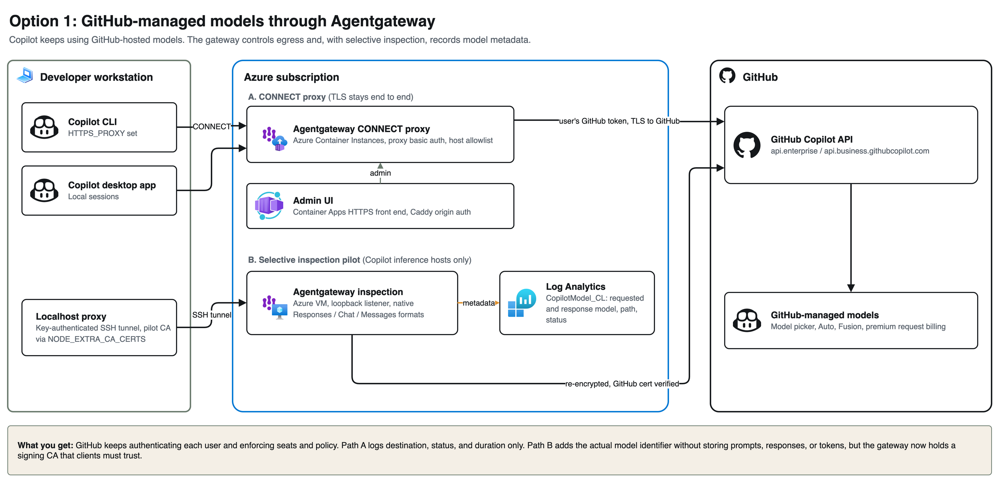
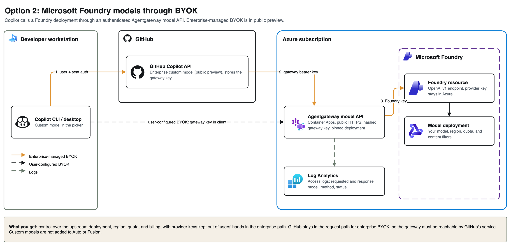
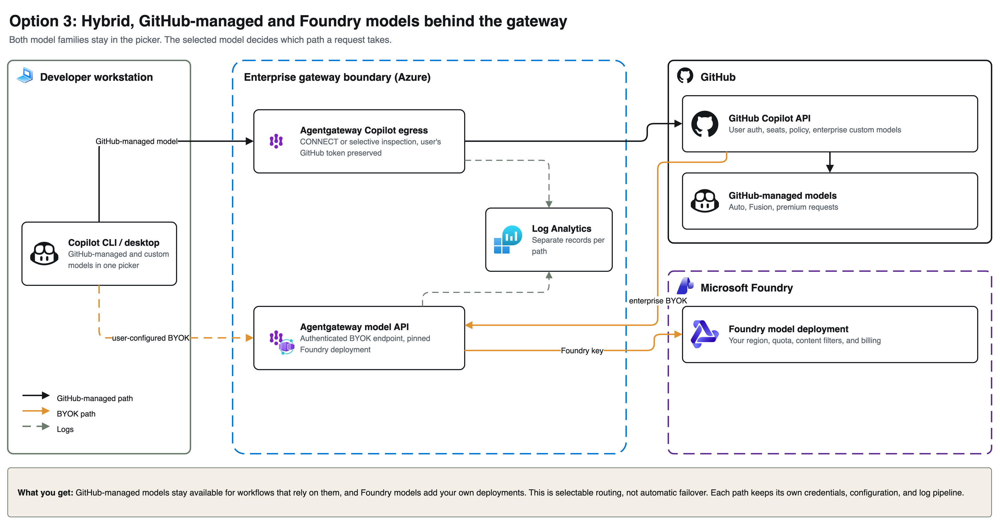
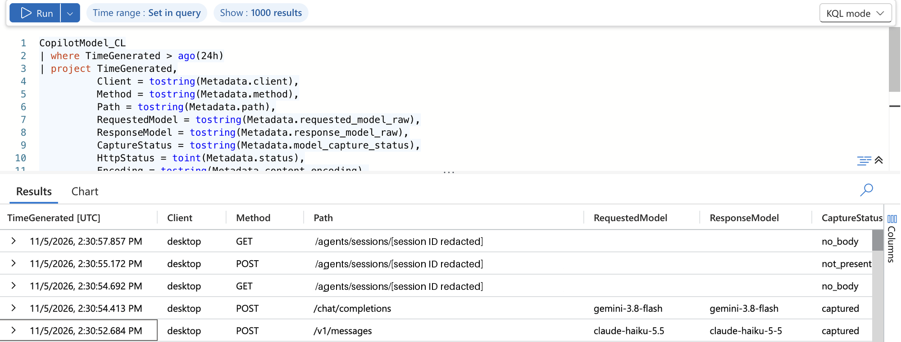

# GitHub Copilot through an enterprise Agentgateway

This proof of concept puts [Agentgateway](https://agentgateway.dev/) on Azure in the request path for GitHub Copilot CLI and desktop local sessions. It covers GitHub-managed models, Microsoft Foundry models through BYOK, and a hybrid that offers both.

The goal is to make model traffic observable and governable without replacing the developer's Copilot workflow. Model choice, credentials, network enforcement, and log retention are platform decisions that affect an agent's entire working session.

> [!IMPORTANT]
> Enterprise- and organization-managed BYOK in GitHub Copilot is currently **public preview and subject to change**. See [GitHub's custom-model documentation](https://docs.github.com/en/copilot/how-tos/administer-copilot/manage-for-enterprise/enable-custom-models).
>
> This is a personal engineering PoC, not an official GitHub or Microsoft reference architecture. It includes deliberate lab constraints. Review the [production boundaries](docs/operations.md) before deploying it for other users.

## The questions this PoC answers

- Can Copilot use GitHub-managed models through an enterprise gateway while retaining each user's GitHub authentication?
- What can an ordinary CONNECT proxy log, and what requires TLS inspection?
- Can the gateway capture the actual model identifier rather than infer it from a model-picker selection?
- How does the request path change when an enterprise adds Foundry models?
- What does a hybrid retain, and where do governance and operational responsibilities move?

## Choose a request path

| Path | Request flow | What the gateway sees | Main tradeoff |
| --- | --- | --- | --- |
| GitHub-managed, CONNECT | Client → gateway → GitHub Copilot | Tunnel destination, status, duration | No decrypted model or prompt |
| GitHub-managed, selective inspection | Client → gateway → GitHub Copilot | Requested/response model and HTTP metadata | A dedicated CA changes the trust boundary |
| Enterprise BYOK | Client → GitHub Copilot → gateway → Foundry | Model API request on the provider leg | Central keys; GitHub remains in the path |
| User-configured BYOK | Client → gateway → Foundry | Model API request sent directly by the client | Client provider setup and credential distribution |
| Hybrid | GitHub-managed path plus a BYOK path | Separate records for each path | More than one authentication and logging boundary |

An ordinary CONNECT tunnel keeps TLS end to end with GitHub. Enabling the gateway UI does not make encrypted model requests visible.

## Architecture

Each diagram is an editable draw.io PNG: open it in [draw.io](https://www.drawio.com/) to change it.

### Option 1: GitHub-managed models



### Option 2: Microsoft Foundry models through BYOK



### Option 3: Hybrid



The public deployment scripts keep the CONNECT proxy, inspection pilot, and BYOK API in separate resource groups. This isolates credentials and trust changes. Agentgateway can host multiple listeners, but these scripts do not merge deployments or provide a shared configuration control plane.

For the request paths and authentication boundaries, see [architecture](docs/architecture.md). An [editable sketch](docs/architecture.excalidraw) is included.

## What the logs look like



*Desktop traffic in Azure Log Analytics. Session identifiers are redacted. The screenshot is cropped; the model values and capture statuses are unchanged.*

The example shows `gemini-3.8-flash` on `/chat/completions` and `claude-haiku-5.5` on `/v1/messages`. Claude's response reports `claude-haiku-5-5`, so requested and response identifiers are stored separately. Calls to session APIs can have no model field.

The inspection implementation persists **metadata**, not prompts, responses, bearer tokens, or cookies. It decodes bodies in memory to read the model field. The `Client` label comes from the harness; it is not an authenticated GitHub identity.

See [log fields and KQL](docs/logs.md) for the query behind the screenshot.

## Reproduce it

You need an Azure subscription, permission to create the relevant resources, and a Copilot client. The examples use macOS for the desktop launcher and Ubuntu for the Azure VM. Agentgateway is pinned to [v1.7.0](https://github.com/agentgateway/agentgateway/releases/tag/v1.7.0).

```sh
git clone https://github.com/sabajamalian/ghcp-agentgateway-poc.git
cd ghcp-agentgateway-poc
cp .env.example .env
# Edit .env: supply your own subscription ID and region.
set -a; source .env; set +a
az login
```

Choose the runbook matching your goal:

1. [GitHub-managed CONNECT proxy and authenticated web UI](managed-proxy/README.md).
2. [Selective inspection and model metadata in Log Analytics](inspection-poc/README.md).
3. [Foundry BYOK endpoint, enterprise registration, and hybrid routing](byok/README.md).

The scripts generate local credentials and certificates. They do not include any credentials, live endpoints, subscription IDs, or raw traffic from the original deployment. Read commands before running them: deploying Azure resources and sending model requests incurs charges.

## Capabilities and tradeoffs

The gateway can enforce destination rules, preserve each user's GitHub bearer token on the managed-model path, and capture model identifiers across Copilot's native inference formats. The inspection pipeline handles compressed request bodies, including zstd. Its Azure monitoring path retains a deliberately small metadata projection.

Foundry adds control over upstream deployments and provider billing. Enterprise BYOK keeps provider credentials out of users' hands. The hybrid leaves GitHub-managed models available for workflows that use them.

Neither a proxy setting nor BYOK alone guarantees that every Copilot feature is covered. Hosted GitHub agents run outside the workstation's network path. A shared gateway key does not establish the developer's identity. Adding a Foundry model does not automatically add it to Fusion or Auto.

Read [findings and approach comparison](docs/findings.md) for the practical details.

## Repository layout

| Directory | Purpose |
| --- | --- |
| `managed-proxy/` | ACI CONNECT proxy, HTTPS admin UI, config backup, smoke checks |
| `inspection-poc/` | VM, SSH tunnel, selective CA inspection, metadata projection, KQL, client harnesses |
| `byok/` | Authenticated Foundry API, Azure Container Apps deployment, enterprise/client setup |
| `docs/` | Architecture, log example, findings, operating boundaries, official references |

Operational checks and fixture tests are described in the runbooks. [Operations](docs/operations.md) covers costs, retention, recovery, rollback, and deletion.

## Sources

Product behavior is linked to official documentation in [references](docs/references.md). Gateway implementation details are pinned to the release used by this repository. Client model catalogs and enterprise-preview behavior can change independently of that pin.

Repository code is [MIT-licensed](LICENSE). Upstream tools retain their own licenses. Product names and logos in the diagrams belong to their respective owners.
