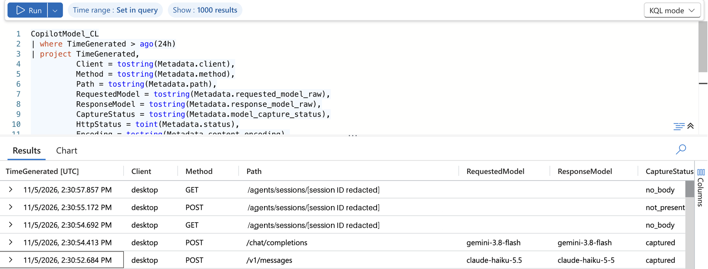

# Reading model metadata

## Azure Portal

Open the inspection resource group's Log Analytics workspace, then **Logs**, and run:

```kusto
CopilotModel_CL
| where TimeGenerated > ago(24h)
| project TimeGenerated,
          Client = tostring(Metadata.client),
          Method = tostring(Metadata.method),
          Path = tostring(Metadata.path),
          RequestedModel = tostring(Metadata.requested_model_raw),
          ResponseModel = tostring(Metadata.response_model_raw),
          CaptureStatus = tostring(Metadata.model_capture_status),
          HttpStatus = toint(Metadata.status),
          Encoding = tostring(Metadata.content_encoding)
| order by TimeGenerated desc
```



*Supplied desktop log example. Session identifiers are redacted and the screenshot is cropped. Other visible field values are unchanged.*

## Interpret the fields

| Field | Meaning |
| --- | --- |
| `requested_model_raw` | Exact request model read by the gateway |
| `response_model_raw` | Model identifier reported in the upstream response |
| `model_source` | The extraction source, usually `llm.requestModel` on typed inference routes |
| `model_capture_status` | Captured, absent, malformed, unsupported, or a body-limit outcome |
| `client` / `run_id` | Harness-supplied correlation labels, not authenticated identity |
| `exchange_id` | Gateway exchange identifier for deduplication |
| `content_encoding` | Helps diagnose compressed traffic |
| `status` | HTTP response status, separate from capture success |

The screenshot's `no_body` and `not_present` rows are session/control requests. An API request without a model field should not be counted as a failed model capture.

The requested and response identifiers may differ in punctuation or name. Keep both raw values. Normalization for reporting should not overwrite the source fields.

## Count requests, not just prompts

[queries.kql](../inspection-poc/queries.kql) includes a per-run view and a deduplicated inference summary. Its inference denominator uses configured POST paths, excludes session APIs and Auto-selection calls, and separates HTTP success from model capture.

Run each query independently. Azure ingestion is asynchronous; a successful reply can precede its log row. Compare exchange IDs when checking ingestion completeness.

## Two other log destinations

The non-inspecting ACI proxy writes access logs to `ContainerInstanceLog_CL`. Those records describe CONNECT tunnels, not decoded inference bodies.

The [BYOK deployment](../byok/main.bicep) writes structured access output to the Container Apps workspace. Query `ContainerAppConsoleLogs_CL` and parse `Log_s` as JSON to read `upstream_requested_model`, `response_model_raw`, and `upstream_deployment`. The native Azure provider rewrites the request model, so this field describes the forwarded model rather than the incoming client alias. `advertised_model_alias` records configuration, not the client's selection.

These are separate pipelines. The scripts do not populate Agentgateway's LLM database/analytics UI or unify every log into `CopilotModel_CL`.

## Data handling

The inspection service pipes gateway stdout through [project_logs.py](../inspection-poc/project_logs.py). Only the metadata projection reaches disk and Azure Monitor. Docker's persistent log driver is disabled for that service.

Prompts, response content, authorization headers, cookies, tokens, and URL queries are not part of the persistent inspection schema. Allowed endpoint paths can still include service-generated identifiers, so logs require access controls. The screenshot's session identifiers were redacted before publication.

Copilot's own local session history is outside this gateway log guarantee. Production log access, retention, notice to users, and permitted purposes are separate organizational decisions.
